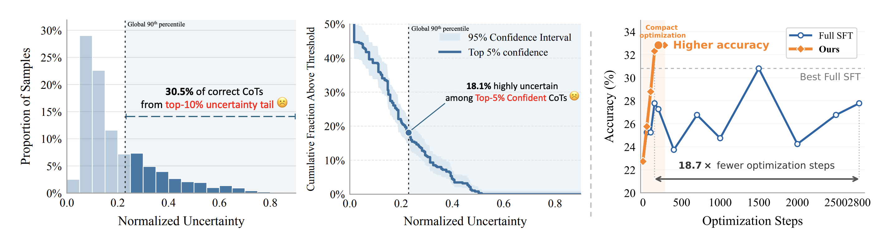
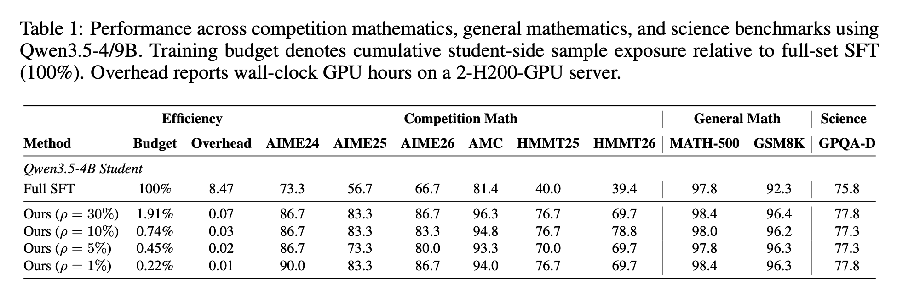
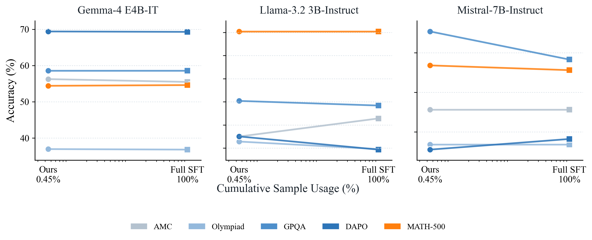
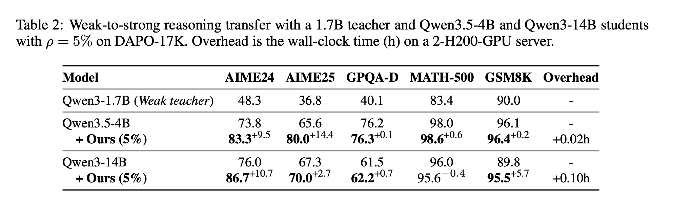

# Learning More by Training Less: Uncertainty-Guided Progressive Contraction for Efficient Reasoning Post-Training

[](https://arxiv.org/abs/2610.12933) [](https://arxiv.org/pdf/2610.12933)

**Can we learn more by training less?** Our method combines process-level uncertainty profiling with learner-aware data routing. It maintains or improves reasoning accuracy with as little as **0.22% of full-data SFT student-side sample exposure**.

<!-- > **Budget** measures student-side sample exposure; teacher generation and uncertainty profiling are excluded. -->

## Overview

Correct final answers can conceal uncertain intermediate reasoning. We identify these informative trajectories and focus training on examples the student still finds difficult.

<p align="center">
  <a href="assets/teaser.png"></a>
</p>

The method has two stages:

1. **Teacher-side contraction:** Monte Carlo reasoning trees identify verified trajectories with high process uncertainty.
2. **Learner-aware contraction:** Student response loss guides subsequent training toward a small, evolving active set.

## Results

### Data-Efficient Reasoning Post-Training

Evaluated on **DAPO-17K** with a **Qwen3-8B** teacher and **Qwen3.5-4B/9B** students.

<p align="center">
  <a href="assets/main_results.png"></a>
</p>

*Qwen3.5-4B portion of Table 1; see the [full paper](https://arxiv.org/abs/2610.12933) for Qwen3.5-9B results.*

### Cross-Family Student Generalization

The same selected data transfers to **Gemma-4-E4B-IT, Llama-3.2-3B-Instruct, and Mistral-7B-Instruct** at about **0.45%** of full-SFT student-side exposure.

<p align="center">
  
</p>

### Weak-to-Strong Transfer

Reasoning supervision from a **Qwen3-1.7B** teacher improves AIME24 and AIME25 performance for stronger **Qwen3.5-4B** and **Qwen3-14B** students.

<p align="center">
  <a href="assets/weak_to_strong.png"></a>
</p>

## Code Release

Code and training configurations are being prepared for release.

## Citation

If you find this work useful, please consider citing:

```bibtex
@misc{yang2026learningmore,
  title         = {Learning More by Training Less: Uncertainty-Guided Progressive Contraction for Efficient Reasoning Post-Training},
  author        = {Suorong Yang and Jiaxin Wang and Jiaming Su and Chentao Yue and Furao Shen and Peng Ye and Soujanya Poria},
  year          = {2026},
  eprint        = {2610.12933},
  archivePrefix = {arXiv},
  primaryClass  = {cs.AI},
  url           = {https://arxiv.org/abs/2610.12933}
}
```
